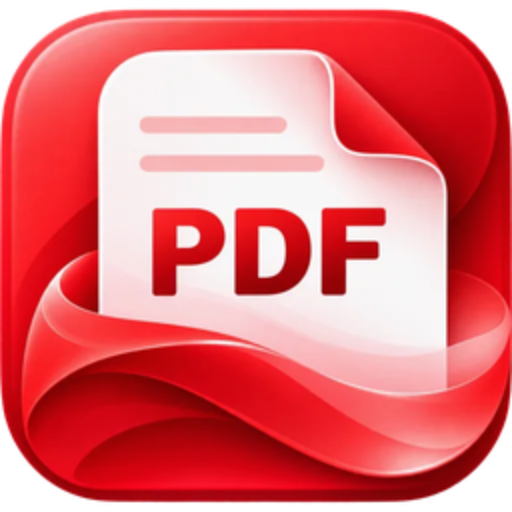

# ChatGPT-generated red PDF app icon

This red PDF app/document icon family is used by the customized **沃飞翼览 PDF v0.10.16** release. The master artwork was generated with ChatGPT from prompts provided by the requester, then supplied by the requester for this project.

The master artwork and its platform variants use the same supplied output. The icon family is separate from the original ArtCraft brand assets and is not an ArtCraft mark. The project does not claim OpenAI endorsement or affiliation.

## Platform resources

| Path | Used by |
|---|---|
| `pdfcraft-source.webp` | Source copy of the ChatGPT-generated artwork |
| `pdfcraft.svg`, `pdfcraft-small.svg` | SVG wrappers containing the supplied raster artwork |
| `pdfcraft-1024.png`, `pdfcraft.icns` | macOS dock, window and app bundle icon |
| `pdfcraft.ico` | Windows executable resources, desktop and Start menu shortcuts, MSI Add/Remove Programs icon |
| `pdfcraft-document.svg`, `pdfcraft-document.ico` | Same red artwork for Windows PDF document icon resource 2 |
| `hicolor/<size>x<size>/apps/ai.storyteller.pdfcraft.png` | Linux theme icons (16–512 px); 256 px variant is also used by the in-app runtime |
| `hicolor/scalable/apps/ai.storyteller.pdfcraft.svg` | Linux scalable icon |

The Windows executable embeds `pdfcraft.ico` and `pdfcraft-document.ico` in `apps/pdfcraft/build.rs`. The MSI uses the same artwork for its application icon, shortcuts and PDF file association. The application runtime uses the PNG variants in `apps/pdfcraft/src/main.rs`.

To regenerate the platform variants from the master SVG, use `packaging/icons.sh` with `resvg`. The ICNS is also generated on macOS. The asset paths and hashes are recorded in `ATTRIBUTION.toml`.

## Provenance and licence

The requester licenses this icon artwork family under **MIT OR Apache-2.0**, at the recipient's option, to the extent permitted by applicable law. See [LICENSE-source.txt](LICENSE-source.txt) for the provenance, license grant and OpenAI Terms of Use caveat. The Windows installer includes that file as `LICENSE-source.txt`, along with the root project licenses, `NOTICE`, `LICENSE-document.txt` and the separate UI icon notice `LICENSE-lucide.txt`.

ChatGPT output may not be unique. This record is not a guarantee that no third-party rights could apply; the requester remains responsible for evaluating the output and its intended use.
